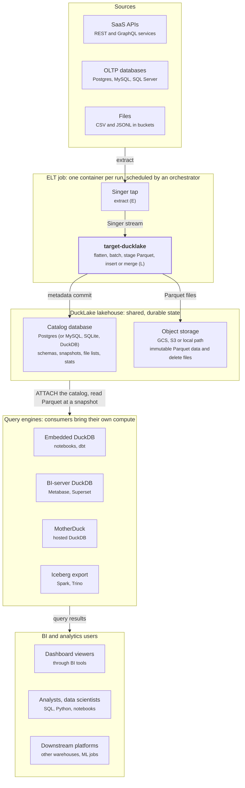
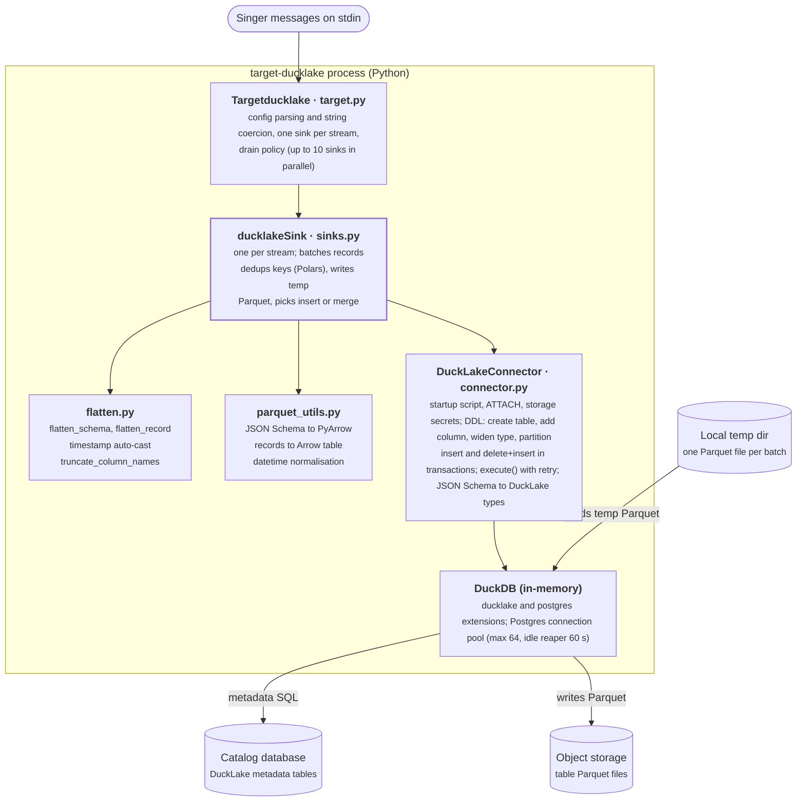

# target-ducklake Architecture

As of 2026-10-15 · Paul Caron · Source doc: <https://claude.ai/code/artifact/ff53910a-45b6-4410-b8a6-b5c7f77e8579>

## Executive summary

target-ducklake is the load stage of an ELT pipeline: it turns a Singer record stream into ACID tables in a DuckLake lakehouse, with Parquet data in object storage and table metadata in a SQL catalog database. BI tools and analysis code then query those tables through any DuckLake-aware engine, with DuckDB as the reference engine.

The target is a Meltano Singer SDK `SQLTarget`. It runs an in-memory DuckDB process, attaches the DuckLake catalog, and writes each batch as a local Parquet file before inserting or merging it inside a single transaction. No long-running server sits in the write path: the target is a short-lived batch job, and the only shared state is the catalog database and the bucket.

High-level architecture, in three layers:

- **Ingest (ELT extract + load).** A Singer tap extracts from a source (SaaS API, OLTP database, files). target-ducklake reads the stream on stdin, flattens and types records, batches them (10,000 records or 10 minutes by default) and loads them.
- **Lakehouse storage.** DuckLake splits storage in two. Data files are immutable Parquet under `data_path` on GCS, S3 or local disk. Metadata (schemas, snapshots, file lists, statistics) lives in a catalog database: Postgres for production, or SQLite, MySQL or a DuckDB file for small setups.
- **Consumption.** Readers attach the same catalog and data path. They get snapshot-consistent reads, time travel and schema evolution without copying data into a warehouse. Transformation (the T in ELT, for example dbt on DuckDB) runs in this layer too.

Why DuckLake: it gives warehouse semantics (transactions, schema evolution, snapshots) on cheap object storage, while keeping metadata in an ordinary SQL database rather than in thousands of manifest files. That keeps commits small and makes many concurrent writers practical.

The end-to-end picture is in **ELT and analytics architecture** below; the target's internals are in **Component diagram**.

## Functional requirements

The target must accept any Singer-compliant stream and land it as a queryable, correctly typed DuckLake table without manual DDL. Each requirement below maps to a config option or code path.

| ID | Requirement | How it is met | Config |
| --- | --- | --- | --- |
| FR-1 | Read Singer SCHEMA, RECORD, STATE and ACTIVATE_VERSION messages from stdin | Singer SDK `SQLTarget` / `SQLSink` base classes | — |
| FR-2 | Write to GCS, S3 or local storage | DuckDB secrets (`CREATE SECRET`) or ambient credentials (IAM role, service account) | `storage_type`, `data_path`, `public_key`, `secret_key`, `region` |
| FR-3 | Use Postgres, SQLite, MySQL or DuckDB as the catalog | `ATTACH 'ducklake:<type>:<url>'` | `catalog_type`, `catalog_url`, `meta_schema` |
| FR-4 | Create target schema and table on first sight | `prepare_target_schema`, `prepare_table` | `default_target_schema`, `target_schema_prefix` |
| FR-5 | Evolve schema: add new columns, widen types safely | `ALTER TABLE … ADD COLUMN`; integer and FLOAT→DOUBLE widening only | — |
| FR-6 | Support append, merge (upsert on key properties) and overwrite | `insert_into_table`, `merge_into_table`, `TRUNCATE` in setup | `load_method` (default `merge`), `overwrite_if_no_pk` |
| FR-7 | Load each batch atomically | `BEGIN TRANSACTION` … `COMMIT` around every DML | — |
| FR-8 | De-duplicate rows within a batch by key | Polars `unique(subset=key_properties)` before write | — |
| FR-9 | Flatten nested objects to columns up to a depth | `flatten_schema`, `flatten_record` | `flatten_max_level` |
| FR-10 | Infer timestamps and normalise time zones | Auto-cast timestamp-like strings; convert to UTC | `auto_cast_timestamps`, `convert_tz_to_utc` |
| FR-11 | Partition tables by identifier or time granularity | `ALTER TABLE … SET PARTITIONED BY (year(col), …)` | `partition_fields` |
| FR-12 | Respect Postgres's 63-char identifier limit | Truncate names, suffix collisions `_1`, `_2` | `max_column_length` |
| FR-13 | Survive transient catalog and storage errors | Retry in `DuckLakeConnector.execute()`, 3 attempts, 2 s then 4 s backoff | — |
| FR-14 | Optionally add Singer metadata columns | `_sdc_*` columns from the SDK | `add_record_metadata` |
| FR-15 | Accept every config value as a string (Kubernetes env vars) | String→int/bool/object coercion in `Targetducklake.config` | — |

Out of scope today: hard or soft deletes from CDC streams (`_sdc_deleted_at`), which the README lists as a TODO, and serving queries. The target only writes.

## ELT and analytics architecture

The target only writes; every reader brings its own engine.

Data moves top to bottom. The ELT job writes once into the shared lakehouse, and every consumer reads through the catalog with its own DuckDB-family engine. Transformations (dbt on DuckDB) run in the engine layer and write models back into the same lakehouse as new tables.

## Component diagram

Python shapes records; DuckDB does every read and write.

The target and sink are thin Singer SDK subclasses; `flatten.py` and `parquet_utils.py` are pure functions with no I/O. All SQL, DDL and retries sit in `DuckLakeConnector`, which owns the single in-memory DuckDB connection that every sink shares. The sink writes the temp Parquet file to local disk; DuckDB reads it and writes the table data to object storage.

## Deployment model

The target deploys as a stateless batch job, one process per tap→target run, next to two managed stateful services: a catalog database and an object-storage bucket. Everything that must survive a run lives in those two services. Local disk holds only temporary Parquet files, which are deleted after each batch.

| Element | Recommended production choice | Alternatives | Notes |
| --- | --- | --- | --- |
| Runtime | Container running `meltano run tap-x target-ducklake`, scheduled by an orchestrator (Airflow, Dagster, Kubernetes CronJob, Meltano Cloud) | Bare `tap \| target-ducklake --config cfg.json` on a VM | Python 3.9+; installed from git via `pip_url` |
| Compute sizing | 2–4 vCPU, memory sized to the largest batch (see Scalability) | Smaller for low-volume SaaS taps | DuckDB is in-process (`:memory:`) |
| Temp storage | Ephemeral volume at `temp_file_dir` | Pod `emptyDir` | Per-stream subfolder `<stream>_<uuid>`, removed in `clean_up()` |
| Catalog | Managed Postgres (Cloud SQL, RDS, AlloyDB) | MySQL; SQLite or DuckDB file for single-user or dev | Only Postgres and MySQL allow multiple concurrent writer processes; optional `meta_schema` isolates DuckLake tables |
| Data storage | GCS or S3 bucket in the same region as compute and catalog | Local path for dev | Data inlining is off (`DATA_INLINING_ROW_LIMIT 0`), so all rows go to Parquet |
| State | Meltano system DB or orchestrator state backend | — | Singer STATE bookmarks, not stored by the target |
| Secrets | Secret manager injected as env vars (`TARGET_DUCKLAKE_CATALOG_URL`, …) | `.env` with `--config=ENV` | `catalog_url` and `secret_key` are flagged secret |

Credentials. Storage access uses either HMAC/access keys (`public_key` + `secret_key`, plus `region` for S3) or ambient workload identity when both keys are omitted. Readers need read access to the bucket and a read-only role on the catalog database; writers need read-write on both.

Environments. Separate dev, staging and prod by catalog database (or `meta_schema`) plus bucket prefix. Two environments must never share a catalog while pointing at different `data_path`s.

A `definite` branch adds a Definite-only GCS credential path and a `meta_role` option. Everything else in this document applies to both branches.

## Consumption alternatives

Any reader must go through the DuckLake catalog, not straight to the Parquet files. Deletes from merges and overwrites leave old files in the bucket until cleanup, so a raw `read_parquet('gs://…/**')` returns stale and duplicated rows. The engines below all resolve the current snapshot through the catalog.

| Option | Engine | How BI or code connects | Best for | Trade-offs |
| --- | --- | --- | --- | --- |
| A. Embedded DuckDB | DuckDB + `ducklake` extension | `ATTACH 'ducklake:postgres:<url>' AS lake (DATA_PATH 'gs://…')` from Python, R, Jupyter, the DuckDB CLI, or dbt-duckdb | Analysts, notebooks, dbt transforms, scheduled analysis jobs | Each client needs bucket and catalog credentials; compute is the client's own machine |
| B. BI tool with a DuckDB driver | DuckDB, in the BI server process | Metabase (DuckDB driver), Superset (`duckdb-engine` SQLAlchemy), Tableau or Power BI (DuckDB JDBC / ODBC), Evidence, Rill, Hex; the connection init SQL runs `INSTALL ducklake; ATTACH …` | Self-hosted BI dashboards | Query concurrency is limited to the BI host's DuckDB; cold cache on first query after restart |
| C. Hosted DuckDB (MotherDuck) | DuckDB in the cloud | MotherDuck DuckLake support; BI tools connect through MotherDuck's drivers | Many concurrent BI users without running query servers | Managed service and cost; check which catalog types and buckets it supports |
| D. Postgres-native access | DuckDB inside Postgres (`pg_duckdb`) | BI tools speak plain Postgres wire protocol | BI tools that only support Postgres | Extra component in the catalog DB or a sibling instance; verify DuckLake support in the installed `pg_duckdb` version |
| E. Shared DuckDB query service | DuckDB behind an HTTP, Arrow Flight or Postgres-wire front end | Custom API or an open-source DuckDB server; BI connects to the service | Central governance, row-level filters, connection pooling | You build and operate the service |
| F. Export to another table format | Spark, Trino, Snowflake, BigQuery, Athena | Copy DuckLake tables to Iceberg (DuckDB's `iceberg` extension) or plain Parquet snapshots on a schedule | Teams standardised on a non-DuckDB engine | Data is copied and lags by the export interval; two sources of truth |

Recommendation: start with A for analysts and dbt, and B for dashboards. Move to C or E once concurrent dashboard users outgrow a single BI host. Use F only where a downstream platform cannot read DuckLake.

Capability notes for every option: readers get snapshot isolation, so a dashboard never sees half of a target's batch. Time travel (`AT (VERSION => n)` or `AT (TIMESTAMP => …)`) supports audits and reproducible analyses. Partition pruning and Parquet min/max statistics stored in the catalog cut the files each query reads.

Ecosystem support for DuckLake is moving quickly. The driver and product names above come from general knowledge as of mid-2026, not from sources checked for this document, so confirm current versions before committing to one.

## High-level design

Each stream gets its own sink. The sink stages every batch as one local Parquet file and loads it with a single transactional SQL statement, so DuckDB does the heavy columnar work and Python only shapes records.

### Stream lifecycle

1. **SCHEMA message → sink init.** Flatten the JSON Schema to `flatten_max_level`, auto-cast timestamp-like fields, truncate long column names (Postgres catalog only), then derive the PyArrow schema and the DuckLake column types.
2. **Setup.** Create the schema if missing. Create the table, or add new columns and widen types on an existing one. Truncate if overwriting. Apply `SET PARTITIONED BY` if configured. Cache the table's column order.
3. **RECORD messages.** Convert `Decimal` to `float`, flatten the record, apply the column-name mapping, and buffer it in the SDK batch.
4. **Drain**, when the batch hits `max_batch_size` or ages past `max_record_age_minutes`. Build a PyArrow table, de-duplicate on key properties with Polars, and write `<stream>_<ts>_<n>.parquet` to the stream's temp folder.
5. **Load.** Run insert or delete+insert from that file in one transaction (table below), then delete the file.
6. **End of stream.** Remove the temp folder and close the DuckDB connection. The SDK emits STATE only after the batches it covers are committed.

### Load methods

| Condition | Path | SQL inside `BEGIN … COMMIT` |
| --- | --- | --- |
| No key properties, or `load_method` = `append` | Insert | `INSERT INTO t SELECT <cols> FROM 'file.parquet'` |
| `load_method` = `overwrite`, or no keys and `overwrite_if_no_pk` | Truncate once at setup, then insert | `TRUNCATE` (setup) then `INSERT` per batch |
| Keys present and `load_method` = `merge` (default) | Delete + insert | `DELETE FROM t WHERE key IN (SELECT key FROM file)`; `INSERT …` |

Merge uses DELETE+INSERT rather than `MERGE INTO` because of a DuckLake bug with partitioned tables ([ducklake#643](https://github.com/duckdb/ducklake/issues/643)). Composite keys are concatenated with `||`. DATETIME keys are cast to VARCHAR for the comparison only.

The insert builds its SELECT list in the table's column order and puts `NULL` where the batch lacks a column. Columns dropped from a source therefore stay in the table and fill with NULLs.

### Type mapping

| JSON Schema | DuckLake type |
| --- | --- |
| `integer` within ±2³¹ | `INTEGER` |
| `integer` otherwise | `BIGINT` |
| `number` | `DECIMAL(38, 9)`, or the schema's precision capped at 38 |
| `object`, `array` (beyond flatten depth) | `JSON` |
| `string` with `date-time` format | `TIMESTAMP` |
| `string`, `boolean` | `VARCHAR`, `BOOLEAN` (SDK defaults) |

### Reliability

Every statement goes through `DuckLakeConnector.execute()`. It retries `duckdb.IOException` (catalog and storage I/O) and `duckdb.Error` messages that match known transient patterns, such as a dropped SSL connection. It makes 3 attempts with 2 s and 4 s waits between them; anything else fails fast.

Retries are safe because each DML runs in its own transaction, so a failed attempt rolls back. No re-ATTACH is needed, because the postgres extension's connection pool resets broken connections. DuckLake's own `ducklake_max_retry_count=100` covers only commit conflicts between concurrent writers, not connectivity.

A crash mid-run loses at most the uncommitted batches. The orchestrator re-runs from the last emitted STATE, and merge makes the replay idempotent. Append and overwrite are not idempotent on replay.

## Scalability and performance

Throughput scales with streams loaded in parallel and with batch size. The limits are per-process memory, the number of small files a batch produces, and commit contention on the catalog. Reads scale separately, because consumers bring their own DuckDB compute.

### Write path

| Dimension | Current behaviour | Scaling lever |
| --- | --- | --- |
| Parallelism across streams | Up to 10 sinks drain concurrently (`parallel_draining`, Meltano default) | Split large taps into several pipeline runs; each run is an independent process |
| Parallelism within a stream | One sink, batches loaded serially | Partition the source (for example by date range) into separate runs writing to the same table; DuckLake resolves commit conflicts with up to 100 internal retries |
| Batch size | 10,000 records or 10 minutes, whichever comes first | Raise `max_batch_size` (for example 100k–1M) for wide-volume streams to get fewer, larger Parquet files and fewer commits |
| Memory | The whole batch is held as Python dicts, then as a PyArrow table, then deduplicated in Polars | Size the container to roughly 3× the in-memory size of one batch per concurrent sink; lower `max_batch_size` or `parallel_draining` if the process is OOM-killed |
| Catalog connections | DuckDB postgres pool capped at 64, idle connections reaped after 60 s | Size Postgres `max_connections` for (concurrent target processes × pool use) plus readers; put PgBouncer in front for many processes |
| Merge cost | `DELETE … WHERE key IN (SELECT key FROM file)` scans the target table's key column | Partition large merge tables so pruning limits the scan; prefer `append` for immutable event streams |
| Network | Parquet is written locally, then read and re-written by DuckDB to the bucket | Co-locate compute, bucket and catalog in one region |

### Read path

| Factor | Effect | Practice |
| --- | --- | --- |
| File count | Each batch adds at least one data file; merges add delete files. Many small files slow every reader | Schedule DuckLake maintenance: `ducklake_merge_adjacent_files`, then `ducklake_expire_snapshots` and `ducklake_cleanup_old_files` |
| Partitioning | Prunes files by time or identifier before reading | Partition on the column dashboards filter by (often `year`/`month` of an event timestamp); avoid high-cardinality identifiers |
| Statistics | Min/max per file live in the catalog, so pruning happens without opening Parquet | Keep catalog Postgres healthy; vacuum it like any OLTP database |
| Reader concurrency | Each DuckDB reader is independent; the catalog sees only small metadata queries | Scale BI by adding DuckDB hosts (or MotherDuck), not by scaling storage |
| Snapshot growth | Every commit creates a snapshot row; long histories grow the catalog | Expire snapshots past the retention window you need for time travel |

### Known bottlenecks and improvements

- **Single-threaded record shaping.** Flattening and dict→Arrow conversion run in Python. For very high volumes, a tap that emits Singer BATCH messages (Parquet or JSONL files) would skip per-record work; the target does not support BATCH yet.
- **Extra local hop.** Writing a temp Parquet file costs one local write and read per batch. It keeps memory bounded and makes the load a single SQL statement, so it is worth keeping.
- **Composite-key merge.** Concatenating keys with `||` defeats per-column pruning and can collide (`'1'||'23'` = `'12'||'3'`). A tuple comparison or a join-based delete would be faster and correct.
- **Diagnostic logging.** Memory logging around every batch calls `psutil` several times; it is cheap but noisy at small batch sizes.

### Sizing starting points

These are starting points to tune from, not measured benchmarks.

| Workload | `max_batch_size` | `parallel_draining` | Container |
| --- | --- | --- | --- |
| SaaS API tap, < 1M rows/run | 10,000 (default) | true | 1 vCPU, 1–2 GB |
| OLTP database tap, 1–50M rows/run | 100,000–250,000 | true | 2–4 vCPU, 4–8 GB |
| Wide or deeply nested records | 10,000–50,000 | false if memory-bound | 2 vCPU, 4–8 GB |
