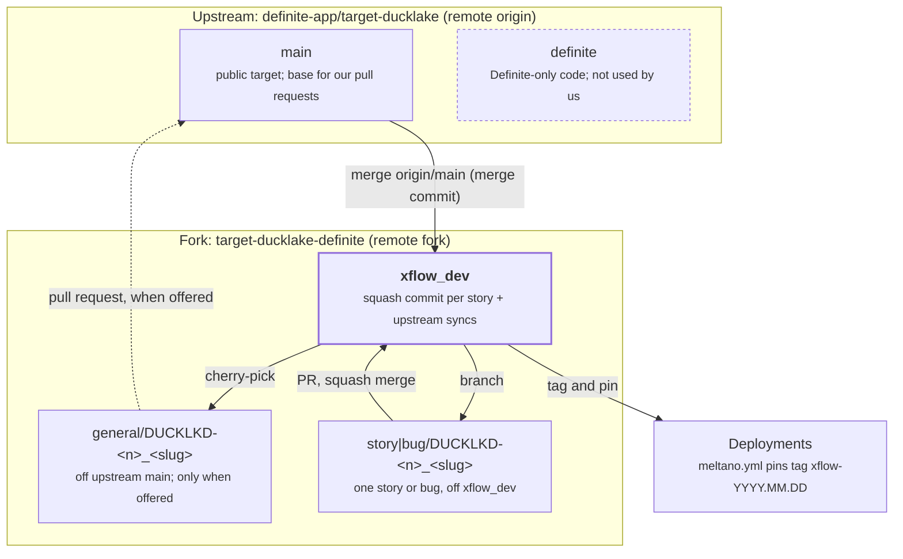

# target-ducklake Fork Development Model

As of 2026-10-17 · Paul Caron · Source doc: <https://claude.ai/code/artifact/81069ffa-592f-4853-a473-bf51fc7213ff>

We extend the Definite target in our fork, [paulcaron16k/target-ducklake-definite](https://github.com/paulcaron16k/target-ducklake-definite), and offer general fixes upstream to [definite-app/target-ducklake](https://github.com/definite-app/target-ducklake) when we choose. We deploy from the fork's `xflow_dev` branch: upstream `main` plus our patches. Work is planned on the [Target DuckLake (Definite fork)](https://github.com/users/paulcaron16k/projects/34) board (key DUCKLKD, managed with `gh agile`). A story or bug is Done when it's merged into `xflow_dev`; an upstream pull request is optional.

Why this model:

- **It stays on Meltano Hub.** The Definite target is the registered DuckLake loader, so improving it avoids a competing variant.
- **Most High gaps are small general fixes.** Upstream has reason to accept them.
- **Deploying costs the same either way.** If upstream merges a patch, our patch set shrinks; if not, we lose nothing.
- **Streaming lives elsewhere.** CDC and broker consumers live outside the Singer target, so they never compete on Meltano Hub.

Upstream is effectively one maintainer, quiet since 2026-05-28, with no outside contributions on record. If our first two or three pull requests get no response within 6–8 weeks, or the core items are rejected, we re-evaluate the dlt-backed target (see Decision checkpoints).

## Remotes and branches



The local clone has two remotes: `origin` is upstream (pull only) and `fork` is ours, where every push goes. Each story or bug branches from `xflow_dev` and returns to it as one squash commit. Upstream changes reach `xflow_dev` by merging `origin/main` as a real merge commit. A fix goes upstream only when we choose, as a `general/` branch made by cherry-picking its squash commit onto upstream `main` (dashed).

## Workflow for a story or bug

Every story starts from the current `xflow_dev`, so it's built and tested against the integration state, and returns as one squash commit through a pull request. Nothing stacks: a story that needs another story's code waits until that story is merged.

1. Move the issue to In Progress and put it in the current sprint: `gh agile move <n> --status "In Progress"` and `gh agile set --issue <n> --field Sprint --value @current`.
2. Branch from the latest integration state: `git fetch fork && git checkout -b story/DUCKLKD-<n>_<slug> fork/xflow_dev`. Use `bug/` instead of `story/` for a bug.
3. Make the change with unit tests. Keep the commit free of fork-only files (`docs/`, `.github/`), so it can be cherry-picked upstream cleanly.
4. Verify: `uv run --python 3.12 pytest tests/ -v`, ruff and mypy compared against upstream's baseline, `pre-commit run`.
5. `git push`, then open the pull request: `gh pr create --base xflow_dev --title "DUCKLKD-<n> <title>" --body "Fixes #<n> ..."`. The fork is the `gh` default, so `#<n>` is our issue. Move the issue to In Review.
6. **Independent review by Sonnet** (next section). The reviewer posts its findings on the PR.
7. Address every finding under the rules for review-driven changes, and reply to each on the PR. If code changed, Sonnet re-reviews the new commits; repeat until nothing blocking remains.
8. You approve, then **squash merge**. The squash commit takes the PR title and body; the branch is deleted automatically.
9. Close the issue with `gh agile move <n> --status Done --evidence "..." --close`, citing the squash commit and the review outcome.
10. Record the merge order and any dependency in `docs/issue_fixes.md`, as a separate docs commit on `xflow_dev`.

Bug or story: an existing function that is clearly not correct is a bug (`type:bug`); a function that could be better or does not exist is a story.

## Independent review by Sonnet

Every PR into `xflow_dev` is reviewed by Claude Sonnet 5.5 (`claude-sonnet-5-5`) before you approve it. The code is written by a different model, so the reviewer doesn't share the author's reasoning or blind spots. It runs as a separate agent and sees only what a human reviewer would: the PR diff and description, the issue's Intent and Acceptance, the repo at `xflow_dev`, and `CLAUDE.md`.

What it checks:

- **Correctness:** bugs, edge cases and failure paths in the changed code.
- **Acceptance:** every Acceptance item is met and covered by a test.
- **Tests:** the new tests would fail without the change, and assert the behaviour rather than the implementation.
- **Regressions:** other load methods, catalog types, storage types and existing tables still behave as before.
- **Unintended consequences:** data already in tables, performance, secrets in logs or errors, behaviour of callers of changed functions.
- **Hygiene:** no fork-only files in the commit, and no new ruff or mypy findings against the baseline.

It posts one PR review comment (`gh pr review --comment`). Findings are numbered, each with a severity (**blocking**, **should fix** or **nit**), a `file:line`, a concrete failure scenario and the test that would catch it. If it finds nothing, it says so. The reviewer never pushes code, approves or merges.

**Rules for changes made in response to a review:**

1. **Reproduce first.** Write a test (or record a check) that fails because of the finding before changing code. If it can't be reproduced, reply with the evidence instead of changing anything.
2. **Keep it minimal.** Change only what the finding needs, as its own commit on the PR branch: `review: <finding #> <summary>`.
3. **Re-verify everything.** Full test suite, ruff and mypy against the baseline, `pre-commit`, and any real-DuckLake check the PR description relies on.
4. **Look for unintended consequences.** Re-read the callers of every changed function, confirm each Acceptance item still holds, and confirm the PR's earlier evidence still holds (tests still fail on the old code).
5. **Re-review.** Sonnet reviews the new commits before you approve; repeat until nothing blocking remains.
6. **Keep the record current.** Update the PR description and the issue's Evidence if behaviour changed.
7. **Declining a finding** needs a reply on the PR with reasoning and evidence; you make the final call.

## Offering a fix upstream

Upstream gets individual fixes, never `xflow_dev`. Each Done story is one squash commit, so offering it is a cherry-pick onto upstream `main`:

```bash
git fetch origin
git checkout -b general/DUCKLKD-<n>_<slug> origin/main
git cherry-pick <squash-commit>
git push
gh pr create --repo definite-app/target-ducklake --base main --head paulcaron16k:general/DUCKLKD-<n>_<slug>
```

Always pass `--repo`: the local `gh` default is the fork. Reword the cherry-picked commit (`git cherry-pick --edit`) to drop the DUCKLKD key, the fork PR number and the `Fixes` line, since they mean nothing upstream. A story that depends on an earlier one (listed in `docs/issue_fixes.md`) is offered after it, or cherry-picked together with it.

| Offer upstream | Keep in the fork |
| --- | --- |
| Correctness bugs: decimal precision, duplicate choice, composite and timestamp keys | Tenant guard tied to xflow's tenancy model |
| Azure storage, `credential_chain` secrets, IAM catalog tokens | `spec.json` for the xflow admin UI and its plugin declaration |
| Hard deletes from `_sdc_deleted_at` | `type_source` coercion if upstream sees it as xflow-specific |
| Per-stream load settings, BATCH messages, `x-sql-datatype` hints | Deployment manifests, CI for our infrastructure |
| Docs that describe the public target | Our design docs and the agile profile |

Rules for an upstream pull request:

- **One topic,** small enough to review in one sitting, with tests.
- **Their conventions:** `general/` branch, base `main`, ruff and mypy clean, Google-style docstrings.
- **Opt-in by default** for anything that changes existing tables or semantics (for example hard deletes). Pure bug fixes ship on by default.
- **No Definite-specific code,** and no references to our fork's issue numbers in their repo.
- **Explain the user-visible effect** and how to reproduce the bug.

## Deploy branch

`xflow_dev` changes only through squash-merged story PRs, upstream sync merges and small docs commits. It is never rebased or force-pushed, so a commit pinned in a deployment stays reachable.

**Bringing in upstream changes:** `git fetch origin && git checkout xflow_dev && git merge origin/main && git push`. This must be a real merge commit, never a squash, so git keeps recognising the shared history. Do it whenever upstream merges anything, and at least monthly.

**When upstream merges one of our fixes:** the sync brings the same change in a second time. It usually merges cleanly; if it conflicts, take upstream's version.

**When upstream declines a fix:** nothing changes here. It stays in `xflow_dev`; mark it fork-only in the patch tracker.

**Fixes made before this model:** DUCKLKD-16 to 18 were merged into `xflow_dev` with merge commits, and their `general/` branches are already based on upstream `main`, ready to offer as they are.

**Pinning a deployment:** reference an exact commit or tag on the fork, never a moving branch:

```yaml
loaders:
- name: target-ducklake
  namespace: target_ducklake
  pip_url: git+https://github.com/paulcaron16k/target-ducklake-definite.git@<tag-or-sha>
```

Tag each deployed build as `xflow-YYYY.MM.DD` on `xflow_dev`. Release notes then list which patches are upstream and which are fork-only.

**Fork settings:** squash merging is on, using the PR title and body; merge commits stay allowed for upstream syncs; rebase merging is off; branches are deleted after merge.

## Patch tracker

The [project board](https://github.com/users/paulcaron16k/projects/34) tracks each issue's status; this table tracks only where each fix stands upstream.

| Issue | Branch | Upstream PR | Upstream status |
| --- | --- | --- | --- |
| [DUCKLKD-16](https://github.com/paulcaron16k/target-ducklake-definite/issues/16) Preserve decimal precision | `general/DUCKLKD-16_decimal-precision` (`c9ba9ca`) | — | In fork, PR not opened |
| [DUCKLKD-17](https://github.com/paulcaron16k/target-ducklake-definite/issues/17) Keep last record per key | `general/DUCKLKD-17_dedup-keep-last` (`a75308d`) | — | In fork, PR not opened |
| [DUCKLKD-18](https://github.com/paulcaron16k/target-ducklake-definite/issues/18) Match composite keys per column | `general/DUCKLKD-18_composite-key-merge` (`48b523d`) | — | In fork, PR not opened |
| [DUCKLKD-19](https://github.com/paulcaron16k/target-ducklake-definite/issues/19) Temporal merge keys never match | squash `4466be0` (fork PR #45) | — | In fork, PR not opened |
| [DUCKLKD-21](https://github.com/paulcaron16k/target-ducklake-definite/issues/21) Honour x-sql-datatype hints | squash `683bd73` (fork PR #46) | — | In fork, PR not opened |
| [DUCKLKD-48](https://github.com/paulcaron16k/target-ducklake-definite/issues/48) Merge keys cast to the table's column types | squash `09a6e91` (fork PR #52) | — | In fork, PR not opened |
| [DUCKLKD-49](https://github.com/paulcaron16k/target-ducklake-definite/issues/49) NULL key values match NULL in merges | squash `8f83caf` (fork PR #54) | — | In fork, PR not opened |
| [DUCKLKD-47](https://github.com/paulcaron16k/target-ducklake-definite/issues/47) Stage timestamps with any fixed UTC offset | squash `f06c733` (fork PR #56) | — | In fork, PR not opened |
| [DUCKLKD-50](https://github.com/paulcaron16k/target-ducklake-definite/issues/50) Honour hints on anyOf properties; reject impossible decimal hints | squash `0bb2fe7` (fork PR #58) | — | In fork, PR not opened |
| [DUCKLKD-59](https://github.com/paulcaron16k/target-ducklake-definite/issues/59) Cap decimals above 38 digits without losing integer digits | squash `ac91dc2` (fork PR #62) | — | In fork, PR not opened |
| [DUCKLKD-60](https://github.com/paulcaron16k/target-ducklake-definite/issues/60) Untyped properties become JSON columns; flatten_schema no longer mutates its input | squash `5e8461c` (fork PR #64) | — | In fork, PR not opened |
| [DUCKLKD-65](https://github.com/paulcaron16k/target-ducklake-definite/issues/65) + [DUCKLKD-66](https://github.com/paulcaron16k/target-ducklake-definite/issues/66) oneOf/allOf/{} properties get columns; choice types keep their declared order | squash `6ca7032` (fork PR #67) | — | In fork, PR not opened |
| [DUCKLKD-70](https://github.com/paulcaron16k/target-ducklake-definite/issues/70) Null in a JSON column is SQL NULL | squash `49d221e` (fork PR #71) | — | In fork, PR not opened |
| [DUCKLKD-69](https://github.com/paulcaron16k/target-ducklake-definite/issues/69) Auto-cast timestamps for choice properties | squash `e5445b9` (fork PR #72) | — | In fork, PR not opened |
| [DUCKLKD-53](https://github.com/paulcaron16k/target-ducklake-definite/issues/53) Match existing columns case-insensitively | squash `4b3880a` (fork PR #73) | — | In fork, PR not opened |
| [DUCKLKD-55](https://github.com/paulcaron16k/target-ducklake-definite/issues/55) convert_tz_to_utc converts date-time text | squash `472e2bc` (fork PR #75) | — | In fork, PR not opened |
| [DUCKLKD-57](https://github.com/paulcaron16k/target-ducklake-definite/issues/57) Mixed-zone batches keep each value's zone | squash `3798b52` (fork PR #76) | — | In fork, PR not opened |
| [DUCKLKD-68](https://github.com/paulcaron16k/target-ducklake-definite/issues/68) + [DUCKLKD-61](https://github.com/paulcaron16k/target-ducklake-definite/issues/61) Staging follows the column type; conflicting hints ignored | squash `2c668e9` (fork PR #74) | — | In fork, PR not opened |
| [DUCKLKD-63](https://github.com/paulcaron16k/target-ducklake-definite/issues/63) Stage numbers at an existing column's type | squash `aac6968` (fork PR #77) | — | In fork, PR not opened |
| [DUCKLKD-51](https://github.com/paulcaron16k/target-ducklake-definite/issues/51) More x-sql-datatype spellings | squash `ab371be` (fork PR #78) | — | In fork, PR not opened |
| [DUCKLKD-79](https://github.com/paulcaron16k/target-ducklake-definite/issues/79) SQLite catalogs drain one sink at a time; failed parallel drains exit cleanly | squash `ebb2e28` (fork PR #80) | — | In fork, PR not opened |
| [DUCKLKD-20](https://github.com/paulcaron16k/target-ducklake-definite/issues/20) Atomic overwrite; ACTIVATE_VERSION retires other versions (soft by default) | squash `87f8e9f` (fork PR #83) | — | In fork, PR not opened |

## Decision checkpoints

We re-evaluate the model at each checkpoint. Any one trigger reopens the dlt-backed target ([feasibility study](target-ducklake-dlt-feasibility.md)) as the main line.

| Checkpoint | When | Trigger to reconsider |
| --- | --- | --- |
| First response | 6–8 weeks after the first three pull requests | No response from the maintainer on any of them |
| Core features | After the Azure, `credential_chain` and hard-delete pull requests | Two or more of these declined |
| Drift | Quarterly | Fork-only patches exceed about a third of the changed lines, or upstream merges conflict every sync |
| Requirements | When a High batch gap needs dlt-only features | scd2, CDC merge or schema contracts become required for batch loads |

Streaming work (CDC apply, broker consumers, exactly-once offsets) doesn't wait on these checkpoints. It is a separate service in any case.
