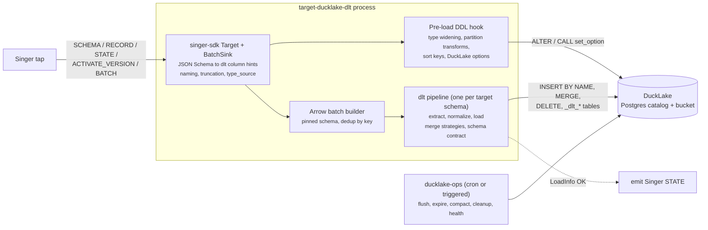

# target-ducklake-dlt Feasibility Study

As of 2026-10-16 · Paul Caron

## 1. Verdict

**Feasible: yes.** A Meltano Singer target that uses dlt's DuckLake destination as its loading backend can be built on dlt 1.31.0 and DuckDB 1.5.2 without forking dlt.

**Feature parity with today's target-ducklake: yes, with a thin custom layer.** dlt handles DDL, column adds, merge SQL, storage secrets (except GCS), retries and load bookkeeping natively. Six behaviours need code of our own on top of dlt:

1. In-place type widening
2. Time-transform partitioning (`year`/`month`/`day`/`hour`)
3. Overwrite that truncates once per stream rather than on every batch
4. A native GCS secret
5. DuckLake ATTACH and table options
6. Column naming identical to the current target (including the 63-character Postgres truncation scheme)

All six are small and use SQL that DuckLake 1.5.2 already supports.

**Enhancements dlt enables:**
- Azure storage
- Merge strategies: upsert (`MERGE`), scd2, insert-only and CDC
- Real hard deletes from `_sdc_deleted_at`
- Parallel table loads on a Postgres catalog
- Schema contracts
- Singer BATCH (Parquet) messages loaded without per-row Python work
- dlt's shared load test suite, which already runs against DuckLake

**Costs to accept:**
- Merges write data twice, because dlt stages them in a `<schema>_staging` dataset inside the lake.
- There are two state stores: dlt's `pipelines_dir` and `_dlt_*` tables, plus Singer STATE.
- dlt brings a heavier dependency footprint.
- Nested objects can't become native DuckLake structs; dlt has no struct type, so they land as JSON.

**Recommendation.** Run a short spike (Phase 0, section 11) against DuckDB 1.5.2, a Postgres catalog and a GCS bucket. It should prove four risks: GCS secrets, table adoption, merge on partitioned tables, and STATE timing. Build the target if the spike passes. If the only goals are Azure and hard deletes, adding them to the existing target is cheaper. The other enhancements are what justify the dlt route.

## 2. Scope and assumptions

- The target performs **EL** only. dbt-duckdb performs **T**, so dlt's lack of dbt support for DuckLake (its docs, line 345) is not a gap.
- Table maintenance (compaction, snapshot expiry, file cleanup) is not a load concern. A separate program supplies it (section 9).
- Baseline versions this study was checked against:

| Component | Version / commit |
| --- | --- |
| dlt | 1.31.0, `3cdf2809d` (`~/checkout/elt/dlt`) |
| DuckDB / DuckLake | duckdb 1.5.2 (DuckLake spec 1.0); extension branch `v1.5-variegata` at `a1cb6b21` |
| target-ducklake | `main` at `e9dc3f3` |
| target-iceberg | `6a76d77` (`~/checkout/xflow.ai/target-iceberg`) |
| singer-sdk | target-ducklake pins `~=0.46.4`; target-iceberg uses `~=0.54.5` |

Evidence labels: **[V]** verified in source, **[D]** from docs, **[I]** inferred.

## 3. Findings carried forward from the dlt review

These claims come from the earlier review of dlt's DuckLake destination. I spot-checked the starred ones in source.

| Claim | Evidence |
| --- | --- |
| The destination lives in `dlt/destinations/impl/ducklake/` (about 800 lines). It subclasses the DuckDB destination and has been in releases since September 2025 (#3015) | [V] |
| Catalogs: sqlite (the default), duckdb, postgres, mysql (docs say "never tested"), MotherDuck (experimental) | [V] `sql_client.py:180-204` |
| Storage: local, S3 (plus R2/MinIO via endpoint), Azure native on duckdb ≥ 1.5.2, GCS only through slower fsspec or the S3-compatible endpoint* | [V] `sql_client.py:135-166` |
| Merge strategies: delete-insert, upsert, scd2, insert-only, cdc. Replace strategies: truncate-and-insert, insert-from-staging | [V] `duckdb/factory.py:177-178` |
| Upsert issues `MERGE` without a DELETE clause; hard deletes run as a separate `DELETE` | [V] `ducklake.py:73-102` |
| Partitioning: identity only, set only at table creation*, requires duckdb ≥ 1.4 | [V] `ducklake.py:203-231` |
| No `ALTER COLUMN TYPE`, ever*. A clashing value creates a variant column `col__v_<type>` | [V] `job_client_impl.py:747-857` |
| Each load file runs as its own `INSERT … BY NAME SELECT * FROM read_parquet(...)`*, read from local disk | [V] `duckdb/duck.py:43-46` |
| No maintenance and no time-travel API; maintenance is left to the user through `pipeline.sql_client()` | [V] docs lines 316-327 |
| Docs lag the code: they say Azure "uses fsspec fallback" and that upsert has no hard deletes. Both are out of date | [V] docs lines 124, 331 |
| State: `_dlt_pipeline_state`, `_dlt_loads`, `_dlt_version` stored as ordinary tables in the dataset | [V] docs line 349 |
| No Singer adapter and no JSON Schema → dlt converter anywhere in dlt | [V] |
| The DuckLake ATTACH statement is fixed, with no DuckLake option knobs. Options go through `set_option` | [V] `sql_client.py:168-211` |

## 4. Proposed architecture

**Design decisions:**

1. **Singer layer.** Keep singer-sdk `Target` + `BatchSink`, as target-iceberg does. It provides config, STATE, BATCH messages and `_sdc_*` columns.
2. **Schema.** Map JSON Schema to dlt `TColumnSchema` once, at SCHEMA time.
   - Map every Singer integer to plain `bigint` (dlt can't widen later).
   - Honour `x-sql-datatype` and `x-singer.decimal`, ported from target-iceberg's `mapping.py`.
   - Declare arrays, and objects past `flatten_max_level`, as `json`. That reproduces SDK flattening and keeps dlt from creating child tables.
3. **Contract.** Use `schema_contract = {tables: evolve, columns: evolve, data_type: freeze}`. A type clash then raises an error instead of silently creating `col__v_*` variant columns. The variant behaviour itself can't be switched off.
4. **Data path.** Build one Arrow table per drain, using the pinned schema. dlt copies Arrow-derived Parquet without rewriting it and doesn't add `_dlt_id` or `_dlt_load_id` [V], so tables stay free of dlt columns.
5. **Commit.** On each SDK drain, run one `pipeline.run([...resources])` covering every full table. Emit Singer STATE only when the returned `LoadInfo` has no failed or pending jobs. That is at-least-once, the same guarantee as today.
6. **Pipelines.** One dlt pipeline per target DuckLake schema (dlt maps one dataset per pipeline). Put `pipelines_dir` on a persistent volume if possible; otherwise rely on dlt's destination state sync.
7. **Pre-load hook.** Before `run()`, a small hook issues the SQL dlt won't:
   - `ALTER COLUMN … SET DATA TYPE` for widening
   - `SET PARTITIONED BY (year(ts), …)` and `SET SORTED BY`
   - `CALL lake.set_option(...)` for inlining, compression and file size
   It uses `pipeline.sql_client()`, which already has the lake attached.
8. **GCS.** Subclass the DuckLake `sql_client` to create a DuckDB `TYPE gcs` secret, the same HMAC secret target-ducklake uses today. Don't switch to the S3-compatible endpoint: existing catalogs store `DATA_PATH gs://…`, and an `s3://` path would not match it.
9. **Retries.** Wrap `run()` in tenacity with exponential backoff, using `dlt.pipeline.helpers.retry_load`. Keep DuckLake's own `ducklake_max_retry_count` and the Postgres pool settings through dlt's `global_config` [I].

## 5. Feature parity with today's target-ducklake

Native = dlt provides it. Custom = our code on top of dlt. Changed = different behaviour, called out.

| Capability (current target) | dlt-backed approach | Status |
| --- | --- | --- |
| Singer SCHEMA/RECORD/STATE/ACTIVATE_VERSION | singer-sdk, unchanged | Native (SDK) |
| Postgres / SQLite / MySQL / DuckDB catalog | `DuckLakeCredentials(catalog=…)`; MySQL is untested in dlt | Native |
| `meta_schema` | `metadata_schema` | Native |
| GCS storage, HMAC keys | Subclassed secret (decision 8) | Custom |
| S3 storage, keys + region | dlt S3 secret | Native |
| Local storage | dlt filesystem | Native |
| Ambient credentials (IAM role, workload identity) | S3/Azure `credential_chain` native; GCS through the custom secret | Native / Custom |
| Auto-create schema and table | dlt DDL | Native |
| Add new columns | `ALTER TABLE ADD COLUMN` | Native |
| Integer / float widening in place | Pre-load hook compares lake types with incoming hints and issues `SET DATA TYPE`. DuckLake 1.5.2 allows integer widenings, float→double and timestamp→timestamptz | Custom |
| Append | `write_disposition="append"` | Native |
| Merge (DELETE+INSERT per batch) | `merge` + `delete-insert`, through the staging dataset | Native, Changed (2× writes) |
| Overwrite / `overwrite_if_no_pk` (truncate once, then insert) | First drain uses `replace`, later drains use `append`; tracked per stream | Custom |
| Atomic per-batch load | Merge follow-up SQL runs in a transaction; each append file is one autocommit `INSERT` | Native, Changed (per file, not per batch) |
| Within-batch dedup on keys | Keep the Arrow/Polars dedup. dlt's `dedup_sort` needs an ordering column | Custom (ported) |
| Flatten to `flatten_max_level` | `json` hints past the level; dlt flattens dicts with a `__` separator | Native with hints |
| `auto_cast_timestamps`, `convert_tz_to_utc` | Keep the existing `flatten.py` logic; set dlt `timezone` hints | Custom (ported) |
| Partitioning: identity + year/month/day/hour | Identity through the dlt `partition` hint; transforms through the pre-load hook | Native + Custom |
| 63-char column truncation (Postgres catalog) | Override capability `max_column_identifier_length=63`. dlt shortens names with a hash suffix, not `_1`, `_2`, so a custom naming convention is needed to keep existing column names | Custom |
| Column-name cleaning compatible with existing tables | Custom dlt naming convention reproducing SQLSink cleaning. `direct` uses `▶` as a separator, so it's unsuitable | Custom |
| Transient error retries with backoff | dlt classifies transient vs terminal errors; add tenacity backoff around `run()` | Native + Custom |
| `DATA_INLINING_ROW_LIMIT 0` | `CALL set_option('data_inlining_row_limit', 0)` once, or leave inlining on as an enhancement | Custom |
| Parallel draining (10 sinks) | Parallel jobs on a Postgres catalog | Native |
| String config coercion for Kubernetes env vars | Keep from the current `target.py` | Custom (ported) |
| `_sdc_*` metadata columns | singer-sdk | Native |
| Temp Parquet staging on local disk | dlt's load files under `pipelines_dir` | Native |

**Adopting existing tables.** dlt reads the lake's existing tables and columns before it generates DDL. It won't recreate tables or drop columns [V]. It also doesn't compare existing column types with its schema [V]. So the first run against a lake written by the current target must use the same naming convention and the same type mapping. Phase 0 must prove this on a copy of a real catalog.

## 6. Enhancements enabled by dlt

| Enhancement | How | Notes |
| --- | --- | --- |
| Azure Blob / ADLS Gen2 | `abfss://` / `az://`, with account key, SAS, service principal or `credential_chain` | Native on duckdb 1.5.2, the version already pinned |
| Upsert through `MERGE` | `merge` + `upsert` | Avoid it on **partitioned** tables: target-ducklake stopped using `MERGE INTO` because of [ducklake#643](https://github.com/duckdb/ducklake/issues/643). Use delete-insert there |
| Hard deletes / CDC | `hard_delete` hint on `_sdc_deleted_at`; `cdc` strategy | Closes the README TODO. target-iceberg can't do this either (ELT-1107) |
| SCD type 2 history | `merge` + `scd2` | Validity columns maintained by dlt |
| Insert-only merge | `merge` + `insert-only` | For immutable keyed events |
| Correct composite keys | dlt merge SQL compares each key column | Fixes the current `||` concatenation collision (`'1'||'23'` = `'12'||'3'`) [I] |
| Per-stream load method, keys and sort order | dlt hints per resource; `SET SORTED BY` through the hook | target-iceberg declares these settings but never implements them |
| Schema contracts | `freeze` / `discard_row` / `discard_value` per table or column | Stricter Bronze layer |
| Singer BATCH messages | `with_file_import(path, "parquet", hints=…)` | Skips per-row Python; large speed-up for BATCH taps |
| Load audit trail | `_dlt_loads` row per committed package | Complements DuckLake snapshots |
| Shared test coverage | DuckLake is in dlt's default SQL test matrix | Merge, scd2, schema evolution and state tests already run against DuckLake |
| Data inlining for small batches | Leave DuckLake inlining on; flush in maintenance | Removes the small-files problem for frequent incremental runs |

## 7. DuckLake capability coverage

The 1.5.2 column says whether the feature is in DuckDB 1.5.2. "main" means it exists only in newer DuckLake (1.1-dev) and is out of reach until the DuckDB pin moves. Where provided: **Load** = during loading (dlt or the pre-load hook); **Ops** = maintenance program (section 9); **Consumer** = a reader feature, nothing for the target to do.

| Category | Capability | 1.5.2 | dlt native | Where provided |
| --- | --- | --- | --- | --- |
| Catalog | DuckDB file / SQLite / Postgres / MySQL | Yes | Yes | Load |
| Catalog | MotherDuck / Quack catalog | main | Experimental | Not yet |
| Catalog | `METADATA_SCHEMA`, `META_*` parameters | Yes | `metadata_schema` only | Load |
| Storage | Local, S3 and compatibles, Azure | Yes | Yes | Load |
| Storage | GCS native secret | Yes | No (fsspec) | Load (custom secret) |
| Storage | `ducklake` secret type, persistent secrets | Yes | No | Not needed |
| ATTACH | `DATA_PATH`, `CREATE_IF_NOT_EXISTS`, `AUTOMATIC_MIGRATION` | Yes | Yes | Load |
| ATTACH | `OVERRIDE_DATA_PATH` | Yes | Yes | Load |
| ATTACH | `READ_ONLY`, `SNAPSHOT_VERSION`/`SNAPSHOT_TIME` | Yes | No | Consumer |
| ATTACH | `ENCRYPTED` (Parquet encryption) | Yes | No | Load (custom ATTACH via subclass; creation time only) |
| ATTACH | `DATA_INLINING_ROW_LIMIT`, `WRITE_DELETION_VECTORS`, `BUSY_TIMEOUT` | Yes | No | Load (`set_option` / subclass) |
| Transactions | ACID, snapshot per commit | Yes | Implicit | Load |
| Snapshots | List / current / last committed | Yes | No | Ops (health report) |
| Snapshots | Commit author / message | Yes | No | Partial: dlt owns the connections, so stamping needs a subclassed job; `_dlt_loads` is the native alternative |
| Time travel | `AT (VERSION / TIMESTAMP)` | Yes | No | Consumer |
| Change feed | `table_changes`, `table_insertions`, `table_deletions` | Yes | No | Consumer / Ops (CDC export) |
| DML | INSERT / DELETE / UPDATE / TRUNCATE | Yes | Yes | Load |
| DML | `MERGE INTO` (single update/delete action) | Yes | Yes (upsert) | Load; avoid on partitioned tables (#643) |
| Constraints | `NOT NULL` | Yes | Yes (`nullable=False`) | Load |
| Schema | Add column | Yes | Yes | Load |
| Schema | Drop / rename column, rename table | Yes | No | Not done automatically (matches both targets); manual |
| Schema | Type promotion (integer widenings, float→double, timestamp→timestamptz) | Yes | No | Load (pre-load hook) |
| Schema | Broader promotion (e.g. tinyint→float) | main | No | Not yet |
| Types | Primitives, decimal, uuid, json, timestamp variants | Yes | Yes | Load |
| Types | Struct / list / map | Yes | No struct type in dlt | Not possible through dlt; lands as JSON |
| Types | Variant, geometry | Yes | No | Not possible through dlt |
| Metadata | Literal `DEFAULT` | Yes | No | Not needed |
| Metadata | Comments on tables and columns | Yes | No | Load (hook from JSON Schema `description`), optional |
| Objects | Schemas | Yes | One dataset per pipeline | Load |
| Objects | Views, macros | Yes | No | dbt / Consumer |
| Layout | Partitioning: identity, year/month/day/hour, bucket(N) | Yes | Identity only | Load (hook) |
| Layout | Partition evolution | Yes | No | Ops (`apply-layout`) |
| Layout | Truncate / void transforms | No | No | Not possible |
| Layout | Sorted tables (`SET SORTED BY`) | Yes | No | Load (hook) / Ops |
| Layout | Data inlining + flush | Yes | No | Load (`set_option`) + Ops (flush) |
| Layout | `target_file_size`, row group size, compression, Parquet version | Yes | No | Load (`set_option`) |
| Layout | Hive-style paths | Yes | No | Default on |
| Stats | Per-file min/max stored in the catalog | Yes | Implicit | Consumer |
| Concurrency | Optimistic commits, automatic retry settings | Yes | Via `global_config` [I] | Load |
| Interop | `ducklake_add_data_files` (register Parquet without copying) | Yes | No | Possible future BATCH fast path; DuckLake then owns the files |
| Interop | Iceberg `COPY FROM DATABASE` | Docs | No | Ops (`export-iceberg`) |
| Interop | Frozen / public read-only lake | Docs | No | Ops (`publish-frozen`) |
| Maintenance | merge_adjacent_files, rewrite_data_files, expire_snapshots, cleanup_old_files, delete_orphaned_files, flush_inlined_data, `CHECKPOINT` | Yes | No | Ops |
| Maintenance | Per-table `auto_compact=false` | Yes | No | Ops config |
| Versioning | Spec 1.0 → 1.1 migration | main | No | Ops guard: **never** run `AUTOMATIC_MIGRATION` from a newer client, because a 1.1 catalog is unreadable by 1.5.2 |

## 8. target-iceberg capability mapping

Each of target-iceberg's 43 capabilities, mapped to the dlt-based target. **Native** = dlt or singer-sdk. **Custom** = port or new code. **N/A** = an Iceberg concept with no DuckLake counterpart. **Not possible** = blocked by DuckLake or dlt.

| # | target-iceberg capability | DuckLake / dlt equivalent | Status |
| --- | --- | --- | --- |
| 1 | REST catalog (Lakekeeper) | DuckLake catalogs are SQL databases; there is no REST catalog. Use Postgres | N/A |
| 2 | SQL catalog | Postgres / SQLite / MySQL / DuckDB | Native |
| 3 | No-auth catalog | Connection string without a password | Native |
| 4 | Bearer-token catalog auth | No HTTP catalog. MotherDuck token only on newer DuckLake | N/A |
| 5 | OAuth2 client credentials | No OAuth catalog. Closest: Cloud SQL / RDS IAM token used as the Postgres password at startup | Custom (optional) |
| 6 | Catalog TLS | libpq `sslmode` / `sslrootcert` in the connection string | Native |
| 7 | Delegated storage (vended credentials, remote signing) | DuckLake has no credential vending; writers need bucket access. Ambient identity (`credential_chain`) is the closest | Not possible |
| 8 | S3 / S3-compatible (endpoint, region, session token, path style) | dlt AWS credentials | Native |
| 9 | GCS | Custom `TYPE gcs` secret (decision 8) | Custom |
| 10 | Azure Blob / ADLS | dlt Azure secret, native on 1.5.2 | Native |
| 11 | Local warehouse | Local `DATA_PATH` | Native |
| 12 | Env-var config with nested flat names | singer-sdk + dlt config providers | Native |
| 13 | Append-only | `append` | Native |
| 14 | Upsert (copy-on-write) | `merge` delete-insert / upsert. DuckLake deletes are always merge-on-read | Native, Changed |
| 15 | Merge-on-read upsert + acknowledgement | Always merge-on-read in DuckLake. Rewriting files is the Ops program's job, so no acknowledgement is needed | N/A |
| 16 | Last-wins dedup in a batch | Arrow dedup keeping the last occurrence before load | Custom (ported) |
| 17 | Atomic full refresh (staging branch + snapshot swap) | No branches. Load batches into a staging table, then swap with `DELETE` + `INSERT SELECT` in **one** DuckLake transaction, so readers see old or new data. Single-run refreshes can use `insert-from-staging` | Custom |
| 18 | `_sdc_deleted_at` kept, rows not removed | Same, or real deletes via the `hard_delete` hint | Native, Enhanced |
| 19 | SDK `_sdc_*` columns | singer-sdk | Native |
| 20 | Default namespace (`elt_raw`), single level | `default_target_schema` → dataset; DuckLake schemas are single level | Native |
| 21 | SQLSink-compatible name cleaning + lossy-rename warnings | Custom dlt naming convention | Custom |
| 22 | Strict typing with `x-sql-datatype` / `x-singer.decimal` | JSON Schema → dlt mapper + `data_type: freeze` | Custom |
| 23 | Nested structs/lists when declared | dlt has no struct type; nested data lands as JSON (or child tables) | Not possible (JSON instead) |
| 24 | Timestamp normalisation | Arrow conversion + dlt `timezone` hint | Custom |
| 25 | Schema evolution: add, safe widening, keep dropped columns | Add: native. Widening: pre-load hook. Dropped columns kept: native (dlt never drops) | Native + Custom |
| 26 | Refusing incompatible type changes and renames | `data_type: freeze` contract | Native |
| 27 | Keys become identifier fields; nullable keys refused | `primary_key` hint, which implies `NOT NULL` | Native |
| 28 | `type_source` coercion for all-string taps | Port `coerce.py`; it doesn't depend on the backend | Custom (ported) |
| 29 | Partitioning at creation, 8 transforms, `table-config.json` | identity, year, month, day, hour, bucket[N] through the hook; reads the same `table-config.json` | Custom; truncate and void Not possible |
| 30 | Fixed table properties (format v2, object storage) | DuckLake options instead: compression, `target_file_size`, Hive paths | N/A, Custom equivalent |
| 31 | Bounded batching | SDK `batch_size_rows` + Arrow | Native |
| 32 | SDK BATCH files (JSONL/gzip, Parquet; local or object storage) | Parquet via `with_file_import`; JSONL through Arrow | Native + Custom |
| 33 | Commit retry with jittered backoff | DuckLake `ducklake_max_retry_count` / `retry_wait_ms` / `retry_backoff` + tenacity around `run()` | Native + Custom |
| 34 | Detecting streams that collide on one table | Port from target-iceberg | Custom (ported) |
| 35 | Tenant guard (warehouse match, location prefix) | Check the catalog's stored `data_path` and `metadata_schema` against config at startup | Custom |
| 36 | Secret redaction | singer-sdk secret flags + dlt secret config types; audit error paths | Custom (audit) |
| 37 | Provenance in snapshot summaries | `_dlt_loads` natively. Per-snapshot `set_commit_message` needs a subclassed load job | Partial |
| 38 | Warning when delete files exceed 10% | Better placed in the Ops `health` report, via `ducklake_list_files` | Custom (Ops) |
| 39 | Fail-closed startup validation | Port the pattern | Custom |
| 40 | STATE emission and record metrics | STATE emitted after a successful `LoadInfo`; SDK metrics | Custom + Native |
| 41 | Meltano plugin declaration, `spec.json`, dev stack | Same artifacts; dev stack is Postgres + MinIO (+ Azurite) instead of Lakekeeper | Custom |
| 42 | Per-stream `write_mode` / keys / `sort_order` (declared, not implemented there) | dlt per-resource hints + `SET SORTED BY` | Custom, Enhanced |
| 43 | Compaction, expiry, orphan cleanup (out of scope there) | Ops program (section 9) | Provided outside the target |

**Summary of the 43:**
- 15 native
- 4 native plus some custom code
- 16 custom or ported
- 4 N/A
- 2 not possible: delegated storage credentials, and native structs
- 1 partial: per-snapshot provenance
- 1 provided outside the target, by the Ops program

Truncate and void partition transforms are also not possible; they are counted within row 29.

## 9. Non-target functionality: `ducklake-ops` program

Everything that keeps a DuckLake healthy but isn't loading goes into one CLI. It ships in the same package and is declared as a Meltano utility plugin. It uses a plain DuckDB connection that attaches the lake with the target's own config, and doesn't need dlt.

### Commands

| Command | What it does | Typical trigger |
| --- | --- | --- |
| `maintain` | Runs, in order: `flush_inlined_data` → `expire_snapshots` → `merge_adjacent_files` → `rewrite_data_files` (tables over the delete threshold) → `cleanup_old_files`. Per-table policy comes from `table-config.json` | Daily cron, or right after a load |
| `orphans` | `delete_orphaned_files`, `dry_run` first, then for real | Weekly cron |
| `checkpoint` | Single `CHECKPOINT` using the options set with `set_option`; the simple alternative to `maintain` | Daily, small lakes |
| `health` | Per table: file count, average file size, delete-file ratio, inlined rows, snapshot count, catalog size, last load (`_dlt_loads`). Outputs JSON and metrics; a non-zero exit when thresholds are breached can trigger `maintain` | After each load; daily |
| `apply-layout` | Applies changes to partitioning, sort keys or table options from config (partition evolution affects new data only) | On config change |
| `export-iceberg` | `COPY FROM DATABASE` to an Iceberg attachment for Snowflake, BigQuery or Athena | Daily, if needed |
| `publish-frozen` | Writes a read-only DuckDB catalog file plus data on a bucket for public or partner sharing | On demand or daily |
| `changes` | Exports `table_changes(start, end)` since the last exported snapshot to Parquet for downstream CDC consumers | Hourly or daily |
| `backup-catalog` | Dumps the catalog schema with the current snapshot id. Data files are immutable, so a catalog backup plus a cleanup window longer than the backup interval gives point-in-time recovery | Daily |
| `version-guard` | Fails if the catalog spec is newer than the pinned DuckDB can read, and blocks `AUTOMATIC_MIGRATION` | Before every load and Ops run |
| `vacuum-catalog` | `VACUUM ANALYZE` on the Postgres metadata tables | Weekly |
| `prune-staging` | Truncates dlt's `<schema>_staging` tables and prunes old load packages in `pipelines_dir` | Daily |

### Scheduling and safety

- **Daily cron:** Kubernetes CronJob or orchestrator task: `maintain`, `health`, `prune-staging`, `backup-catalog`. Weekly: `orphans`, `vacuum-catalog`.
- **Triggered:** chain after a load (`meltano run tap-x target-ducklake-dlt ducklake-ops:maintain`), or let `health` breaching a threshold start `maintain`.
- **One maintainer at a time:** take a Postgres advisory lock (`pg_try_advisory_lock`) so two Ops runs never overlap.
- **Avoid load collisions:** compaction conflicts with concurrent deletes and drops on the same table. Schedule outside heavy merge windows and rely on DuckLake's commit retry.
- **Retention:** `expire_older_than` defines the time-travel and CDC window (suggest 7–30 days). `cleanup_old_files` must be longer than the longest read transaction (DuckLake's default is 2 days).

## 10. Risks and mitigations

| Risk | Severity | Mitigation |
| --- | --- | --- |
| Silent variant columns or child tables if hints are incomplete | High | Pin every column; `data_type: freeze`; declare arrays as `json`; unit-test the mapper against real tap schemas |
| Adopting existing tables: name or type mismatch creates duplicate columns | High | Custom naming that matches SQLSink + truncation; Phase 0 against a copy of a production catalog |
| Not atomic across tables; partial appends on failure | Medium | Same at-least-once contract as today; prefer merge for keyed streams; persist `pipelines_dir` so dlt resumes pending jobs instead of reloading |
| Merge doubles writes (staging dataset in the lake) | Medium | Bigger batches (100k+ rows); `append` for event streams; `prune-staging` + compaction in Ops |
| `MERGE` on partitioned tables (#643) | Medium | Force `delete-insert` when a table is partitioned |
| No type widening in dlt; integer width can't change | Medium | Map integers to bigint; pre-load hook for existing narrower columns |
| GCS without a native secret | Medium | Subclass secret creation (decision 8) |
| Two state stores (dlt + Singer) | Low | STATE emitted only after success; dlt destination state sync covers a lost `pipelines_dir` |
| Retries without backoff in the dlt loader | Low | tenacity around `run()` |
| Dependency footprint (gitpython, sqlglot, …); singer-sdk version alignment | Low | Move to singer-sdk 0.54 to match target-iceberg; check the lock file |
| dlt docs lag the code | Low | Rely on source, and pin the dlt version |

## 11. Phased plan

| Phase | Scope | Size | Exit criteria |
| --- | --- | --- | --- |
| 0. Spike | Minimal Target + mapper + dlt pipeline on duckdb 1.5.2, Postgres catalog, GCS custom secret | S | Loads a 3-stream tap; adopts tables written by target-ducklake with no DDL drift; STATE emitted only after commit; delete-insert on a partitioned table works |
| 1. Parity | Naming/truncation, widening hook, partition transforms, overwrite-once, dedup, flatten/timestamp ports, retries, startup validation | M | Port target-ducklake's unit tests; side-by-side load of the same tap into two lakes gives identical tables |
| 2. Enhancements | Azure, upsert/scd2/cdc/hard deletes, per-stream hints, BATCH import, sort keys, DuckLake options | M | dlt merge-strategy tests pass against our hints; Azure end-to-end with Azurite |
| 3. target-iceberg extras | `type_source`, collision detection, tenant guard, atomic full refresh, `spec.json`, plugin declaration | M | Config parity tests modelled on target-iceberg's |
| 4. `ducklake-ops` | `maintain`, `health`, `orphans`, `backup-catalog`, `version-guard`, `prune-staging`; then the export commands | S–M | Daily CronJob on a dev lake keeps file count and snapshot count bounded |

## 12. Open questions

- Should the new target replace target-ducklake on `main`, or live beside it as `target-ducklake-dlt`? The second avoids breaking existing users during migration.
- Is the Definite GCS ADC path (`definite` branch) needed? If so, decision 8's secret must also support a credential chain.
- Is the doubled merge write acceptable for the largest keyed streams, or do those need a custom delete-insert that reads the local Parquet directly, as the current target does?
- Keep data inlining off (today's behaviour) or turn it on and rely on `flush_inlined_data` in Ops?
- Is moving DuckDB beyond 1.5.2 on the roadmap? Bucket pruning, broader type promotion, the MotherDuck catalog and inline `PARTITIONED BY` / `SORTED BY` DDL all need newer DuckLake, and a 1.1 catalog is unreadable by 1.5.2 clients.

## Sources

- dlt source and docs: `~/checkout/elt/dlt` (`dlt/destinations/impl/ducklake/`, `dlt/destinations/impl/duckdb/`, `docs/website/docs/dlt-ecosystem/destinations/ducklake.md`)
- DuckLake extension: `~/checkout/ducklake/duckdb_ducklake_extension` (branch `v1.5-variegata` for 1.5.2), `~/checkout/ducklake/ducklake-docs.md`, `ducklake-faq.md`
- target-iceberg: `~/checkout/xflow.ai/target-iceberg`
- target-ducklake: this repository, `docs/ARCHITECTURE.md`
- Operator context: `~/checkout/ducklake/duck-lake-vs-iceberg-definite.md`
